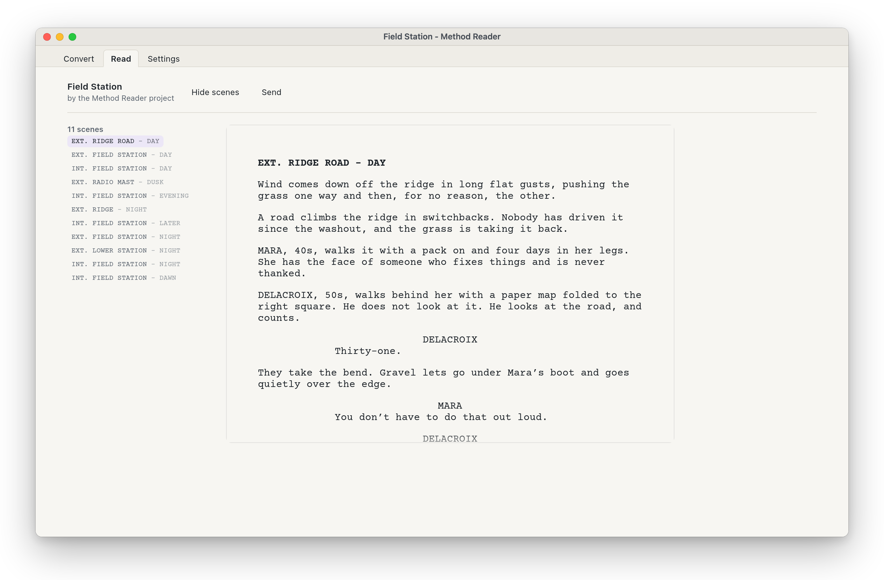
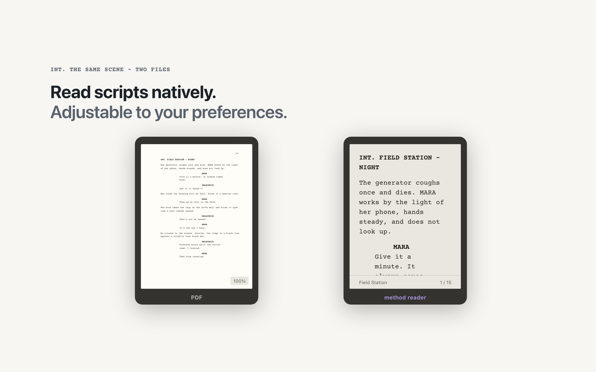
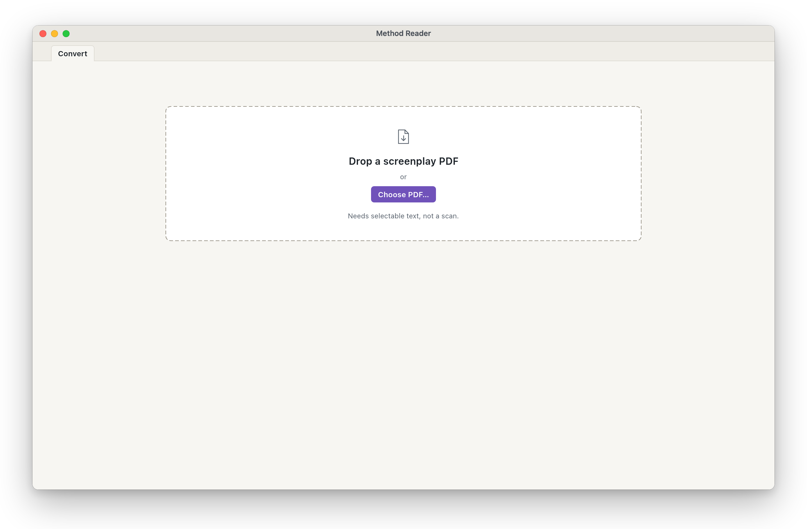
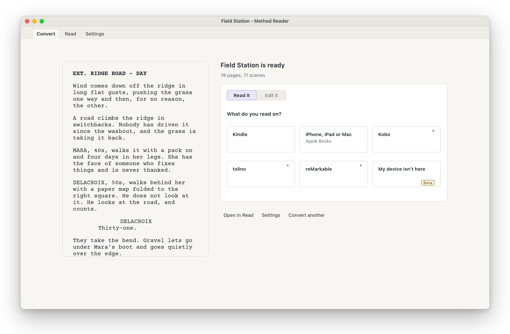
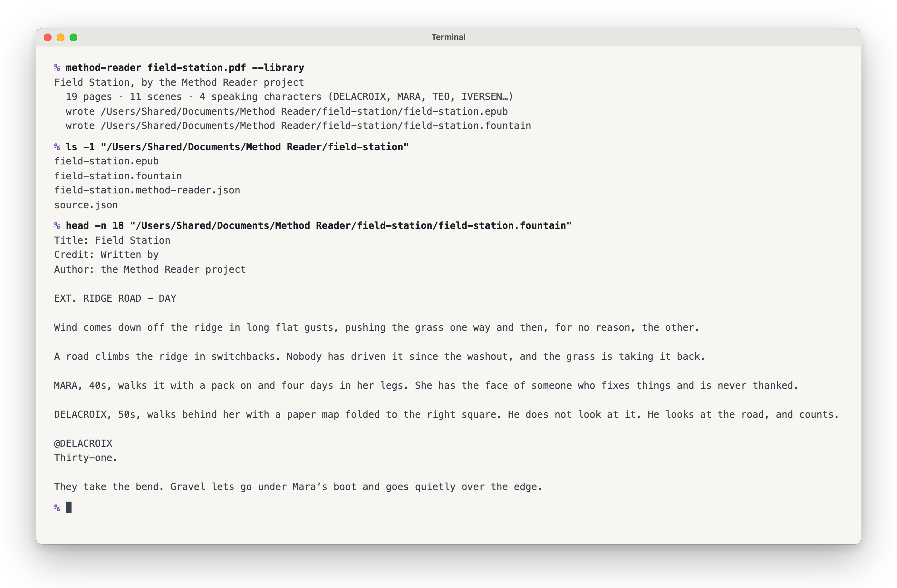

# Method Reader

**Turn a screenplay PDF into an e-book for your Kindle or other e-reader,
or into a script you can edit again (Fountain or .fdx).**

Method Reader is the new name for Screepub, and it is part of the
[Method Production Suite](https://github.com/method-production-suite). Same
app, same books: updating from Screepub keeps your settings and your library.

  <a href="https://github.com/method-production-suite/method-reader/releases/latest/download/Method-Reader-macOS.dmg"><strong>Download for Mac</strong></a>
  &nbsp;·&nbsp;
  <a href="#install"><strong>Other platforms</strong></a>
  &nbsp;·&nbsp;
  <a href="https://methodreader.com"><strong>Take the tour at methodreader.com</strong></a>

  <picture>
    <source media="(prefers-color-scheme: dark)" srcset="assets/screens/read-dark.png">
    
  </picture>

You get scripts as PDFs, and an ordinary PDF-to-ebook converter wrecks them:
dialogue collapses into paragraphs and character names drift away from their
lines. Method Reader reads how the scenes, cues and dialogue actually sit on the
page and rebuilds a real e-book from that structure, so it reflows at any text
size and still holds its shape. From the same structure it writes the script
back out as a file you can edit: Fountain, or .fdx for screenwriting apps.

  <picture>
    <source media="(prefers-color-scheme: dark)" srcset="assets/screens/compare-dark.png">
    
  </picture>

## What it does

- **Drop a PDF, get a clean e-book.** Nothing to set up first.
- **Send it to your reader, straight from the result.** Say once what you
  read on, and one button does the rest: plug in a Kindle and it copies over
  in the right format, then offers to eject it (beta on Windows and Linux).
  Every other way to send, and every file type Method Reader makes, is under
  Other ways.
- **Look before you send.** A built-in reader shows the script as the device
  will, and the Settings page changes margins, spacing and page numbers live.
  "Use these for new scripts" makes your choices the starting point for every
  script after.
- **Built for real scripts.** Dual dialogue, revision marks, watermarks,
  page-break interruptions and offbeat character cues, with bold, italic and
  underline carried across.
- **Get the script back to edit.** The same PDF also comes out as a script
  you can keep writing in: Fountain, or .fdx (beta), which most
  screenwriting apps open. It is rebuilt from the page, so revision colors
  and the exact page breaks stay behind.
- **Pictures from the script (beta).** Storyboard panels, photos and a
  designed title card come across into the e-book where they sat, and a
  title card that opens the script becomes the book's cover. Both are
  switches on the Settings page. The MOBI, the file for the oldest Kindles,
  stays text only for now.
- **Free and open source.** No account, no subscription, nothing uploaded.

  <picture>
    <source media="(prefers-color-scheme: dark)" srcset="assets/screens/drop-dark.png">
    
  </picture>
  <picture>
    <source media="(prefers-color-scheme: dark)" srcset="assets/screens/result-dark.png">
    
  </picture>

## Yours to keep

- **Free, for good, and open source** (MIT OR Apache-2.0; the AZW3 writer is
  GPL v3, [see below](#license)). No account and no subscription.
- **Nothing is uploaded.** Converting happens on your computer and works
  offline; [your script stays on your machine](#your-script-stays-on-your-machine).
- **Plain files you can open anywhere, in 20 years:** an EPUB 3 book
  ([the standard](https://www.w3.org/TR/epub-33/)), and the script as
  [Fountain](https://fountain.io/syntax) text or as .fdx for screenwriting apps.
  Nothing writes your script for you: every word in the book is the PDF's own.

  <picture>
    <source media="(prefers-color-scheme: dark)" srcset="assets/screens/cli-dark.png">
    
  </picture>

## Which readers?

| Device | How it's sent | Status |
| --- | --- | --- |
| Kindle that mounts as a drive | Over USB: KFX when your computer has the tools for it, otherwise an AZW3 Method Reader makes itself (beta); MOBI for the oldest Kindles | KFX verified on hardware, firmware 5.19.2; Method Reader's own AZW3 not yet tried on a Kindle |
| Any Kindle, by email | EPUB to your `@kindle.com` address | Verified |
| Newer Kindles that don't appear as a drive | Email, or Amazon's Send to Kindle app or web page | Use email delivery |
| iPhone, iPad, Mac (Apple Books) | Added to Books on a Mac, then synced through iCloud | Verified |
| Kobo | EPUB (or KEPUB) over USB | Built and tested in code, never on a real device |
| tolino | EPUB into the device's `Books` folder | Built and tested in code, never on a real device |
| reMarkable | The EPUB over its USB web interface | Built and tested in code, never on a real device |

**What each Kindle file needs.** Copying to a Kindle over USB needs nothing
installed: Method Reader writes the AZW3 itself (beta: Calibre's own reader opens
every one in our tests, and it has not yet been tried on a Kindle). KFX is
optional, and looks better: it needs three free tools on your computer
(Calibre, Amazon's Kindle Previewer and the KFX Output plugin), and Other
ways, on the result screen, lists what is missing and installs the plugin for
you. Emailing the EPUB to your Kindle, or sending it with Amazon's Send to
Kindle, needs no tools at all and already gets Amazon's own best layout.

**How well a Kindle keeps a scene together depends on the file.** A script
emailed to your Kindle, or copied over USB as KFX, keeps a scene heading and a
character name on the same page as the line that follows. AZW3 and MOBI can
strand one at the foot of a page, and so can Apple Books.
A newer Kindle that never shows up as a drive speaks a protocol your computer
does not mount: see [Emailing scripts to your Kindle](docs/send-to-kindle.md).

**Own a Kobo, a tolino or a reMarkable?** A five-minute report either way is
the most useful thing you can send. On the result screen, that reader's
asterisk opens a note ending in **It worked** and **It did not work**; press
one, or
[open an issue](https://github.com/method-production-suite/method-reader/issues/new/choose)
to say more. A reader that is not on the list goes in **My device isn't
here** on the same screen (beta).

**What beta means here.** A feature marked (beta) works in our tests, but
has not been tried widely on real devices or apps yet: tell us how it goes.

## Install

**On a Mac, download `Method-Reader-macOS.dmg`**: the Mac app, signed and
notarized by Apple, for Macs with Apple silicon, macOS 13 or
later. It is the file the download button gives you, and it updates itself.
The same app runs on Windows and Linux.

**On an Intel Mac, 0.9.0 is the last version**, released under the app's
earlier name, Screepub. It keeps working, but it will not be offered updates.
To install it, download `Screepub-macOS.dmg` from
[the 0.9.0 release page](https://github.com/method-production-suite/method-reader/releases/tag/v0.9.0).

| Computer | File | Status |
| --- | --- | --- |
| Mac | `Method-Reader-macOS.dmg` | Verified by a person on an Apple silicon Mac |
| Windows, 64-bit | `Method-Reader-windows-x64-setup.exe` | Built and checked automatically. Never installed by a person yet |
| Linux: Debian, Ubuntu | `Method-Reader-linux-amd64.deb` | Built and checked automatically. Never installed by a person yet |
| Linux: Fedora, openSUSE | `Method-Reader-linux-x86_64.rpm` | Built and checked automatically. Never installed by a person yet |
| Linux: any other, 64-bit | `Method-Reader-linux-x86_64.AppImage` | Built and checked automatically. Never run by a person yet |

Every file is on the [latest release](https://github.com/method-production-suite/method-reader/releases/latest).
`SHA256SUMS-app` there covers these five files, and `SHA256SUMS`
covers the command-line downloads. Reports from Windows and Linux are welcome:
[open an issue](https://github.com/method-production-suite/method-reader/issues/new/choose).
Who has checked what, in full: [the verification ledger](docs/verification-ledger.md).

**Windows will warn you.** The Windows downloads are unsigned, so SmartScreen
shows a "publisher unknown" screen the first time: choose **More info**, then
**Run anyway**.

**Sending to a reader is only proven on a Mac.** On Windows and Linux,
converting is well tested and sending to a device has never been tried on
real hardware; a tolino cannot be detected on Windows at all, because Windows
gives a drive no name to recognise it by. On Windows and Linux the window does
not update itself: download each new version by hand.

There is also a command-line converter for macOS, Linux and Windows:
[for developers](docs/developers.md#install-the-command-line-converter). On a
Mac with Apple silicon, Homebrew installs it too: `brew install --formula ssandweiss/tap/method-reader`.

## Help build it

**If you read or make films:** start with an issue labelled
[help wanted: film knowledge](https://github.com/method-production-suite/method-reader/labels/help%20wanted%3A%20film%20knowledge); no code needed. The most useful thing is a report from a
reader nobody here owns (a Kobo, a tolino, a reMarkable, or a reader that is
not on the list yet; [see above](#which-readers)), or a script whose layout
comes out wrong. Describe the problem in
[an issue](https://github.com/method-production-suite/method-reader/issues/new/choose)
and never attach or quote a real script: an invented page that shows the same
problem is enough, and the issue form says how to make one.

**If you write code:** start with an issue labelled
[good first issue](https://github.com/method-production-suite/method-reader/labels/good%20first%20issue).
`cd rust && cargo test --workspace` checks everything, and
[CONTRIBUTING.md](CONTRIBUTING.md) covers the rest.

Method Reader is part of the [Method Production Suite](https://methodproduction.com):
free, open tools for making films, from the first draft to the last shoot day.

## Your script stays on your machine

Scripts are confidential. Method Reader is built accordingly.

- **No AI, no machine learning.** The conversion is ordinary code that
  measures where text sits on the page and applies screenplay layout rules.
- **Converting never touches the network**, on any platform. Your PDF is read
  from disk and the e-book is written back to disk.
- **No accounts, no telemetry, no analytics.** Nothing tracks usage or reports
  crashes.

Method Reader uses no network except checking for updates, which you can
turn off. On a Mac, two minutes after the window opens and every six hours
after that, it fetches one small file, `latest.json`, from Method Reader's
releases on GitHub. The request carries the app's name and version
(`method-reader-update/` and the version number) and nothing else: no
account, no identifier, nothing about your scripts. GitHub sees your
internet address, as any website's host does. When a newer version is
there, the window downloads it, checks its signature, and says **Update
ready, restart to update**; nothing is replaced until you restart. To turn
the checks off, uncheck **Help > Check for Updates Automatically**;
**Help > Check for Updates…** still checks once when you ask. If you said no
to the old once-a-day question, they stay off. On Windows and Linux the
window neither checks nor updates itself.

Otherwise it reaches the network only when you ask it to:

- **A docked reMarkable**: the upload goes over USB to your own tablet, not
  the internet.
- **Pages it opens in your browser**: GitHub for **Report a Bug** and the
  User Guide, methodreader.com and methodproduction.com from the Help menu,
  Amazon's Send to Kindle page and its Kindle settings page, and the Calibre
  and Kindle Previewer download pages.
- **Installing the KFX plugin**: fetched from Calibre's own plugin index.
- **Method Reader's request service**, only when you press **Send** in **My device
  isn't here** or answer **It worked** or **It did not work** beside an
  asterisk. It carries the device's name (or which reader and your answer),
  the app's version and your platform, and nothing else. The service stores
  only counts and the day: never your address or anything made from it.
  Cloudflare, which runs it, sees your address as any website's host does,
  and uses it to allow five requests a minute.

On a Mac the result screen can also hand a book to another app and stop there:
Amazon's Send to Kindle app, Apple Books (which syncs through iCloud if you
use it), or a Mail message that goes nowhere until you send it.

If you email a script to your `@kindle.com` address, Amazon receives it and
their terms apply. That's your call, and Method Reader never makes it for you.
The [source is right here](rust/crates/) to check any of this.

## What Method Reader isn't

- **Not a screenwriting app.** It reads scripts that already exist.
- **Not a coverage or analysis tool.** No summaries, no notes, no AI.
- **Not a PDF viewer.** It makes an e-book you read on a device built for
  reading.

## For developers

Method Reader is a PDF to Fountain to EPUB3 pipeline written in Rust, as one
Cargo workspace. The window is native (egui, with AccessKit for screen
readers) and has the engine linked in. The command line, the library layout and
the architecture are in [docs/developers.md](docs/developers.md); setting up
and sending a change is in [CONTRIBUTING.md](CONTRIBUTING.md).

## Independent

Method Reader is an independent project by Method Production Suite Team and the
Method Reader contributors, not affiliated with or endorsed by the makers of any
e-reader, reading app or screenwriting app it works with. Kindle, Kobo, tolino,
reMarkable, Apple Books, Calibre and Final Draft are named only to say which readers
and file formats it works with; their trademarks belong to their owners.

## License

Method Reader's code is licensed under the **MIT License or the Apache License
2.0**, at your option: see [`LICENSE-MIT`](LICENSE-MIT) and
[`LICENSE-APACHE`](LICENSE-APACHE). Use any part of it in your own project,
open or closed.

One crate is the exception: the AZW3 (Kindle) writer,
[`rust/crates/sp-azw3`](rust/crates/sp-azw3), is ported from calibre and
stays under calibre's licence, the **GNU GPL v3**
([`LICENSE-GPL-3.0`](rust/crates/sp-azw3/LICENSE-GPL-3.0)). The PDF reader,
the parser, and the Fountain and Final Draft writers don't use it. Because
the command line and the app contain it, the released programs as a whole
are distributed under the GPL v3.

Bundled third-party components are listed in
[`THIRD-PARTY-NOTICES.md`](THIRD-PARTY-NOTICES.md), which also ships inside
the apps.

Copyright © 2026 Method Production Suite Team and the Method Reader contributors.
